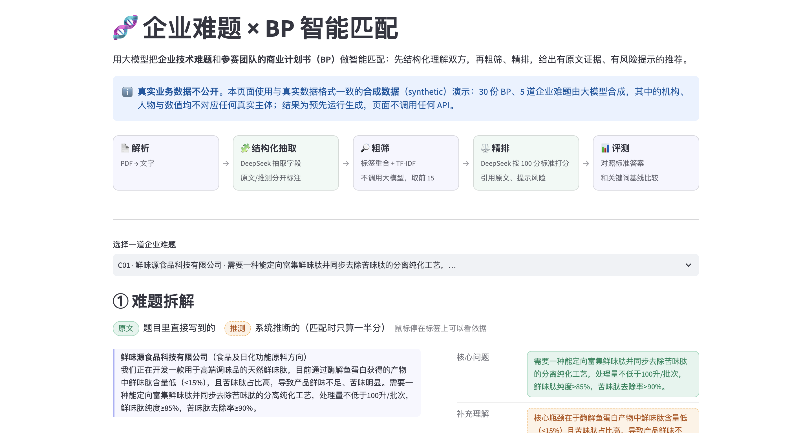
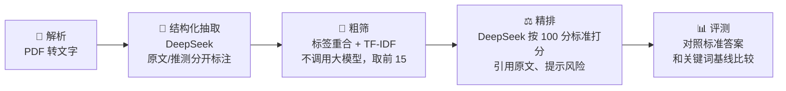

# 企业难题 × BP 智能匹配

用大模型把<b>企业发布的技术难题</b>和<b>参赛团队的商业计划书（BP）</b>做智能匹配：先把双方结构化，再经过"粗筛 + 精排"两段，给出有原文证据、有风险提示、可追溯的推荐名单。



> 真实业务数据（企业技术难题、参赛团队 BP）涉及商业保密，不随仓库公开。仓库使用与真实数据格式一致的**合成数据**进行演示和评测，详见[数据和隐私说明](#数据和隐私说明)。

---

## 背景和问题

**揭榜挂帅**是科技成果对接中常见的组织方式：企业把自己解决不了的技术难题"张榜"发布出来，由高校、科研团队、创业公司"揭榜"，提出解决方案。在创新创业大赛里，组织方手上同时有两类材料：

- 企业发布的技术难题：往往只有一两句话，有的还夹着大段政策背景
- 参赛团队的 BP：一页纸的项目简介，数量动辄上百份，里面的数据大多是团队自报、尚待核实

组织方要为每道难题找出真正能解决它的团队。靠人工逐份阅读费时费力，也依赖懂行的专家。最直接的自动化办法是**关键词匹配**，但它有三个典型问题：

| 问题 | 例子（来自合成评测集） |
|---|---|
| **字面像，但其实解决不了** | 难题要"鲜味肽的分离纯化工艺"，关键词匹配会把"鲜味肽含量检测试剂盒"排得很靠前，因为两者的关键词几乎一样，但后者只做检测、不做生产 |
| **说法不同，就漏掉了** | 难题说"提高乳酸菌制剂的耐高温存活率"，能解决它的项目可能说的是"热休克蛋白调控 + 冻干保护剂配方" |
| **看不出依据和风险** | 只给一个相似度分数，对接人员不知道为什么推荐它、哪些说法还没核实 |

## 目标用户和使用场景

| 用户 | 场景 | 他们需要什么 |
|---|---|---|
| **赛事、园区、孵化器的对接运营人员**（主要用户） | 赛前为每道难题准备候选团队名单 | 快速拿到一份靠谱的短名单，而不是从上百份 BP 里自己翻 |
| **出题企业的技术负责人** | 对接会前了解候选团队 | 每个推荐为什么合适、原文证据在哪、还有哪些风险需要当面问 |
| **评审专家** | 复核推荐结果 | 能看出哪些判断有原文依据，哪些只是系统推测出来的 |

产品定位：**辅助决策，不替代人**。系统输出的是带证据和风险的候选名单，最终是否对接由人判断。

## 方案设计



### 1. 结构化抽取：先把双方变成同一套"语言"
- BP 和难题都抽取成相同的字段：核心技术/问题、工艺环节、应用领域、目标产物、产业化阶段、关键指标等
- **工艺环节、应用领域用固定清单**（9 个工艺环节、7 个应用领域），只能从清单里选。否则同一件事会有几十种说法，没法比对
- 难题里的政策背景、"市场推广"这类非技术诉求会被删掉，删了哪些话会单独列出来，方便人工核对

### 2. 区分"原文"和"推测"：让每个判断都能追溯
企业难题往往只有一句话，很多信息只能靠推测。如果把推测和原文混在一起，后面的匹配就会建立在"系统自己的想象"上。所以：

- 每一条内容都标注来源：**原文**（附原话）或**推测**（附推测理由）
- 标"原文"的内容由**程序核对**：引用的原话必须在原文里真实存在；核心问题只能从原文里删字得到，不能加字
- 匹配时，**推测出来的标签只算一半分**；精排时只依据推测内容得到的分数也会扣一半，并单独列出来

### 3. 两段式匹配：兼顾成本和判断质量
- **为什么不全交给大模型**：5 道题 × 100 多份 BP = 500 多次大模型调用，又慢又贵，而且大部分候选一看就不相关
- **粗筛（不调用大模型）**：标签重合度和 TF-IDF 文本相似度各占一半，每道题先取前 15 个候选。中文按字切分（单字 + 相邻两字），不需要额外安装分词模型
- **精排（大模型）**：只对这 15 个候选逐个评估，调用次数降到 75 次左右
- 出题企业自己的 BP 不参与匹配，避免把企业推荐给它自己

### 4. 评分标准：把"像不像"变成"能不能解决"
| 维度 | 分值 | 看什么 |
|---|---|---|
| 技术相关度 | 40 | BP 的核心技术和产品，能不能直接解决难题的核心问题 |
| 工艺环节匹配 | 25 | 难题涉及的工艺环节，BP 是否显示出实际能力（不是只提到名词） |
| 成熟度 | 15 | 有明确要求时看是否达到；没有要求时按 BP 所处阶段给分 |
| 证据强度 | 20 | 有没有量化数据、对照条件和可核查的证据 |

- 技术相关度权重最高：解决不了问题，其他都无从谈起
- **总分由程序计算**（各项得分 − 推测扣分），不直接采用模型自己算的总分
- 每个推荐都要**引用 BP 原文作为证据**（程序核对原文里确实有这句话），并列出**差距和风险**，方便对接时有针对性地提问
- 参考分档：75 分以上"推荐对接"，60–74 分"可以考虑"，60 分以下"匹配度低"

## 效果评测

真实业务数据既不能公开，也没有现成的标准答案，因此按真实数据的格式构建了一套**合成评测集**：30 份 BP、5 道难题，每道题预先设定标准答案，并有针对性地设置了两类陷阱：

- **陷阱 a**：关键词和难题高度重合，但其实解决不了（例如只做检测、只在摇瓶规模）
- **陷阱 b**：用的是另一个技术圈子的术语，关键词对不上，但其实能解决（算正确答案）

生成数据和运行系统完全分开，系统运行时看不到标准答案。

| 指标 | 关键词基线（TF-IDF） | 完整系统（粗筛 + 精排） |
|---|---|---|
| **陷阱 a 被识别**（关键词像但解决不了，没进前 3） | **0/5** | **4/5** |
| 陷阱 a 被误推荐（得分 ≥ 60） | — | 0/5 |
| Top-3 召回率（每题 2 个正确答案平均找回几成） | 90% | 100% |
| 陷阱 b 被识别（关键词不同但能解决，进了前 3） | 4/5 | 5/5 |
| 陷阱 b 达到推荐线（得分 ≥ 60） | — | 3/5 |
| Top-3 命中率（前 3 里至少 1 个正确答案） | 5/5 | 5/5 |
| Top-1 准确率（第 1 名就是正确答案） | 5/5 | 5/5 |

**最大的差别在陷阱 a**：关键词基线 5 道题**全部**把"关键词像但解决不了"的项目排在第 2 名；完整系统把其中 4 个挤出了前 3，给的分只有 25–33 分。剩下 1 个虽然排在第 3，但只有 34 分，远低于推荐线。**5 个陷阱 a 没有一个被推荐。**

也要如实说明：Top-3 命中率两种方法都是 100%，说明这套评测集偏简单；样本只有 5 道题。完整的方法、每道题的排名和局限见 [docs/evaluation.md](docs/evaluation.md)。

## 迭代过程

项目经过 6 轮迭代，每一轮都是"小样本试跑 → 人工检查 → 定位问题类型 → 改规则或加程序检查 → 重跑对比"。几个有代表性的发现：

- 光靠提示词约束不住模型时，改成**程序硬性检查 + 重试时把错误原因告诉模型**
- 让模型**先列出要删掉的内容，再写结论**，"删不干净"的问题就解决了
- 修一个重复扣分的漏洞时，发现**精排打分本身有随机波动**，于是改成直接核对扣分记录来确认修复效果，而不是只看总分

详见 [docs/iteration_log_public.md](docs/iteration_log_public.md)。

## 已知局限和下一步

| 局限 | 影响 | 下一步 |
|---|---|---|
| **精排打分有随机波动** | 同样的输入重跑一次，每对总分平均变化 2–3 分、最大约 12 分；相差 5 分以内的名次不可靠 | 每对打 3 次取中位数，或让模型只做"是/否/部分"判断、分数由程序换算 |
| **评测集偏简单** | Top-3 命中率拉不开差距；数据由同一个模型生成和评判，结果可能偏乐观；标准答案没有经过专家确认 | 加入"同领域但不相关"的干扰项目，请领域专家确认标准答案，在真实数据上抽样做人工标注 |
| **粗筛可能漏掉正确答案** | 标签没对上时，正确答案可能在粗筛阶段就被淘汰 | 标签、文本两路分别召回再合并 |
| **推测扣分偶尔判断错** | 抽查约 7% 的扣分理由不成立 | 增加程序对扣分理由的校验 |
| **应用领域对照表换一批数据就不够用** | 新数据出现大量对照表里没有的写法，需要人工补充 | 抽取时直接从 7 个类别里选 |
| **PDF 提取会丢失上标** | 例如"10⁶"会变成"10"，比较具体数字时要注意 | 换用保留版面格式的提取方式 |
| **BP 信息是团队自报的** | 很多指标标注"待核实"，证据强度普遍偏低 | 推荐结果里保留风险提示，由人工核实 |

## 数据和隐私说明

- **真实数据不公开**：开发时使用的真实 BP 和企业难题、以及由它们产生的结果，都放在 `data/`、`output/` 里，已通过 `.gitignore` 排除，不会上传
- **公开部分使用合成数据**：`demo_data/` 中的 30 份 BP、5 道难题由大模型按真实数据的格式合成，每份文件开头标注 `【SYNTHETIC｜合成数据】`，其中的机构、人物与数值均不对应任何真实主体
- **防止泄露真实信息**：生成时程序检查不能出现真实数据里的公司名和项目名，也不能和真实 BP 有 20 字以上的相同片段；生成后又人工审核了全部公司名，改掉了和真实企业、品牌太像的名字
- **网页演示只读合成数据**：`app.py` 只读取 `demo_data/`，不调用任何 API。运行时记录过程序打开的每一个文件，确认没有读取 `data/`、`output/`
- **密钥**：DeepSeek API Key 放在本地的 `.env` 文件里，不上传

## 如何运行

### 1. 安装
```bash
python3 -m venv .venv
.venv/bin/pip install -r requirements.txt
# 国内网络慢的话，可以加上：-i https://pypi.tuna.tsinghua.edu.cn/simple
```

### 2. 打开网页演示（不需要 API Key）
```bash
.venv/bin/streamlit run app.py
```
然后在浏览器打开 http://localhost:8501

### 3. 用合成数据重跑整个流程（需要 DeepSeek API Key）
在项目根目录新建 `.env` 文件，写入 `DEEPSEEK_API_KEY=你的密钥`，然后：
```bash
export BPM_DATASET=demo                       # 切换到合成数据；不设置时默认是真实数据
.venv/bin/python src/extract_structured.py    # BP 结构化抽取
.venv/bin/python src/normalize_fields.py      # 应用领域归并
.venv/bin/python src/structure_challenges.py  # 企业难题结构化
.venv/bin/python src/match_coarse.py          # 粗筛
.venv/bin/python src/match_rerank.py          # 精排
.venv/bin/python src/match_report.py          # 生成匹配报告
.venv/bin/python eval/evaluate.py             # 对照标准答案评测，更新 docs/evaluation.md
```

### 项目结构
```
├── app.py                  网页演示
├── src/                    匹配系统（只读取 BP 和难题，不读取标准答案）
├── eval/                   合成数据生成、评测
├── config/                 应用领域对照表等配置
├── demo_data/              合成数据和运行结果（可公开）
└── docs/                   评测报告、公开版迭代记录
```

## 技术栈

- **Python 3.13**
- **DeepSeek**（`deepseek-chat`，通过 OpenAI 兼容接口调用）：结构化抽取、精排打分、生成合成数据
- **PyMuPDF**：PDF 转文字
- **scikit-learn**：TF-IDF 文本相似度
- **Streamlit**：网页演示
- **pandas / openpyxl**：表格处理

本项目使用 **Claude Code** 辅助开发。
